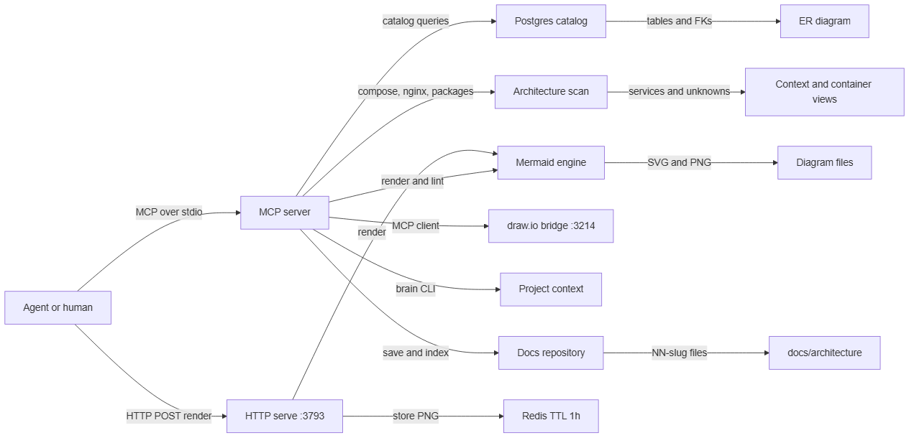
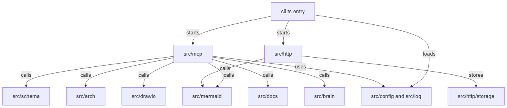
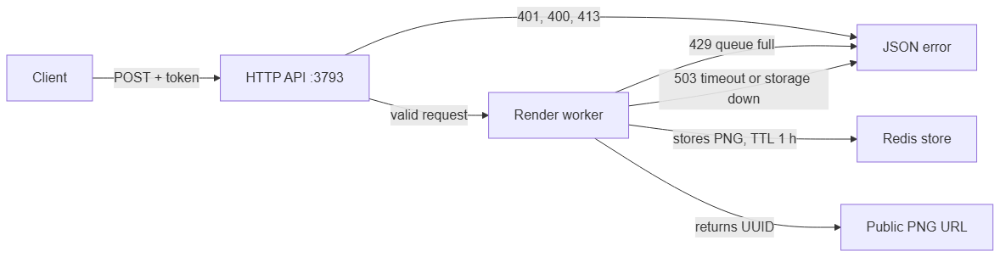

# lv24-diagram architecture

Status: v0.2.1 · Date: 2026-11-27
Rationale and trade-offs live in [design.md](design.md); this page describes the system as built.
The product front door is the [README](../README.md); agent rules are [AGENTS.md](../AGENTS.md).

## 1. Purpose and scope

`lv24-diagram` is one local MCP server that replaces the usual three-tool glue (Mermaid renderer,
database explorer, draw.io bridge) for architecture work. It:

- renders and lints Mermaid with `mermaid-isomorphic` + Chromium;
- builds ER diagrams from a **live** PostgreSQL catalog, never from migrations or memory;
- scans a repository's compose, nginx, and package files into architecture views;
- proxies a curated subset of a shared draw.io MCP server;
- stores diagrams as `NN-slug.mmd/.svg/.png` with an index and a manifest;
- optionally reads/writes a digest through the `lv24-brain` CLI;
- serves an opt-in HTTP render API for the city diagram desk.

**It is not:** a diagram host or cloud renderer, a generic multi-engine SQL client, a draw.io
reimplementation, a migration parser, or a tool that invents missing services. Anything unresolved
is reported in `unknowns`, not drawn.

## 2. System context

Actors and external systems:

- **Agent or human** — an MCP host (OpenCode, Claude, etc.) over stdio, or `curl` against HTTP mode.
- **Chromium** — installed by Playwright; required only for rendering. Lint, schema, arch scan, and
  save work without it.
- **PostgreSQL** — read-only catalog source for tables, columns, keys, and relations.
- **draw.io MCP server** — a single shared process at `127.0.0.1:3214` (editor WebSocket on 3337).
- **Redis** — HTTP-mode PNG storage only; not used by stdio mode.
- **`lv24-brain` CLI** — curated project context in, idempotent digest note out. Optional and
  best-effort; a missing brain never blocks a diagram.

Trust boundaries: stdio is local-only; the database is read-only by construction but the SQL guard is
explicitly a guardrail, not a permission boundary; HTTP is token-gated for writes and public for
reads by design; draw.io is local and shared per machine.

## 3. Runtime components

| Component | Responsibility | Entry file | Transport / store |
|---|---|---|---|
| CLI | Parse commands, load config, dispatch | `src/cli.ts` | process |
| MCP server | Register 14 tools, stdio JSON-RPC | `src/mcp/server.ts` | stdio |
| HTTP server | Opt-in render API and Swagger | `src/http/server.ts` | `127.0.0.1:3793` |
| Mermaid engine | Parse, lint budget, render SVG/PNG | `src/mermaid/{parse,lint,render}.ts` | Chromium |
| Schema engine | Catalog queries, ER model | `src/schema/{postgres,er}.ts` | PostgreSQL (read-only) |
| Architecture scan | Compose/nginx/package extraction, views | `src/arch/{scan,diagram}.ts` | filesystem |
| draw.io bridge | Health, import Mermaid, export page | `src/drawio/client.ts` | MCP over HTTP `:3214` |
| Docs repository | `NN-slug` files, `README.md` index, `.diagrams.json` | `src/docs/repository.ts` | filesystem |
| Brain adapter | `brain open` / `brain note`, redaction | `src/brain/client.ts` | subprocess |
| HTTP storage | PNG by UUID, TTL 3600 s | `src/http/storage.ts` | Redis `diagram:v1:png:*` |
| Render queue | Concurrency 1, waiting room 4 | `src/http/queue.ts` | in-process |
| Config / log | Discovery, env substitution, stderr logging | `src/config.ts`, `src/log.ts` | files / env |

The runtime is assembled once in `createRuntime` (`src/mcp/server.ts`) and shared by the MCP tools.
The HTTP server builds its own dependencies (`src/http/server.ts`) so tests can inject a fake renderer
and storage. There is no daemon state beyond the open PostgreSQL client, the draw.io client, and the
HTTP queue.

## 4. Source layers

| Layer | Owns | May depend on |
|---|---|---|
| `src/cli.ts` | argument parsing, command dispatch, process exit code | every layer |
| `src/mcp` | tool surface, input schemas, runtime wiring | mermaid, schema, arch, drawio, docs, brain, config, log |
| `src/http` | routes, auth, validation, queue, PNG fit, OpenAPI, storage | mermaid, log |
| `src/mermaid` | Mermaid parse, lint, render | node, mermaid-isomorphic, playwright |
| `src/schema` | PostgreSQL catalog and ER generation | node, pg, mermaid types |
| `src/arch` | compose/nginx/package scan and views | node, yaml |
| `src/drawio` | MCP client for the shared editor | node, MCP SDK |
| `src/docs` | file naming, manifest, generated index | node |
| `src/brain` | CLI adapter and secret redaction | node |
| `src/config.ts`, `src/log.ts`, `src/version.ts` | shared primitives | node |

Dependency direction is downward only. `src/mermaid` knows nothing about MCP or HTTP; that is what
lets the same engine serve stdio, CLI `render`, and the HTTP service without a second renderer.

## 5. Key flows

### 5.1 MCP render and save

1. The host starts `lv24-diagram mcp`; `loadConfig` discovers `diagram.config.json`.
2. A tool call arrives over stdio. `registerTool` validates its Zod schema.
3. `diagram_render` renders through `mermaid-isomorphic` + Chromium and returns a text summary plus
   an image block. All logs go to stderr; stdout carries protocol frames only.
4. `diagram_lint` parses the graph and reports node count, depth, cycles, unlabeled edges, longest
   label, and sequence/ER budgets.
5. `diagram_save` writes `NN-slug.mmd`, `.svg`, `.png`, updates `README.md`, and updates
   `.diagrams.json`. The `.mmd` is the source; exported files are generated.
6. Unless disabled, `diagram_save`, `schema_er`, and `arch_diagram` publish one idempotent brain
   digest keyed by the manifest content hash.

### 5.2 Architecture scan

1. Walk the repository, skipping hidden directories and build output; cap at `arch.maxFiles`
   (default 4000).
2. Parse `docker-compose*.yml` (including `!override` / `!reset` overlays) into services and
   `depends_on` edges.
3. Parse nginx files: `server_name`, `proxy_pass`, `set $var`, and `upstream` blocks. Resolve hosts
   against compose service names.
4. Read `package.json` names and workspaces.
5. Emit services, edges, packages, sources, and **unknowns**. Missing compose files, unresolved
   variables, unknown proxy targets, and dangling dependencies stay visible.
6. `buildArchDiagram` renders `container`, `context`, or `deploy`; container view collapses to 20
   nodes and reports the collapse instead of hiding it.

Running the scanner on this repository (`node dist/src/cli.js scan . --json`) is the honest
baseline: one package (`lv24-diagram`), zero services, zero edges, and one unknown — “No
docker-compose*.yml found; deployment topology is unknown.” The tool does not invent a deployment it
cannot see.

### 5.3 HTTP render path

`lv24-diagram serve` is opt-in and starts only with a non-empty token from the variable named by
`--token-env` (default `DIAGRAM_API_TOKEN`). Defaults: host `127.0.0.1`, port `3793`, Redis
`redis://127.0.0.1:6379`.

1. `POST /v1/render` checks `x-lv24-diagram-token`. Missing/invalid → 401 `DIAGRAM_UNAUTHORIZED`.
2. Storage health is checked before work; Redis down → 503 `STORAGE_UNAVAILABLE`.
3. Chromium presence is checked; missing → 503 `DIAGRAM_UNAVAILABLE`.
4. Body is read with a 64 KB cap (413), parsed as JSON (400), and validated: `mermaid` 10–4000
   characters, theme enum, optional title 1–80.
5. Mermaid is linted with a 40-node hard budget; `%%{init}%%` and `click` directives are rejected
   with 400 `DIAGRAM_INVALID` and structured `findings`.
6. The job enters a queue with concurrency 1 and waiting room 4; overflow → 429 `DIAGRAM_BUSY`.
7. The renderer runs with a 10 s timeout; timeout or render failure → 503 `DIAGRAM_UNAVAILABLE`.
8. The PNG is downscaled so its long side is at most 2400 px, stored in Redis for 3600 s, and
   returned as `{id, width, height, bytes, mermaid}`.
9. `GET /v1/diagrams/{uuid}.png` is public and immutable for one hour; unknown/non-v4 IDs → 404.
10. `/health`, `/docs`, `/docs-json` are public. `/health` reports Chromium, storage, and queue state.

### 5.4 ER from the live catalog

`schema_tables` ranks relations by `reltuples` (never a scan); `schema_columns` uses
`information_schema` plus PK/UK metadata; `schema_er` builds relations from `pg_constraint` and uses
single-column uniqueness for cardinality (`o|` for a unique FK, otherwise `o{`). Dropped relations
are reported, not silently lost.

### 5.5 Brain digest

`brain_context` runs `brain open . --json` and returns goal, next action, and active items.
`brain_publish` composes a short note (directory, diagram list, content hash, timestamp), strips
credentials with `redactSecrets`, and writes through the CLI. If the manifest hash is unchanged, it
skips the write. Brain failure is reported in the tool result but never fails the diagram work.

## 6. Data ownership and storage

| Data | Owner | Retention / rule |
|---|---|---|
| `.mmd` sources | repository | permanent; the only editable diagram source |
| `.svg` / `.png` exports | repository | generated; never hand-edited |
| `docs/architecture/README.md` | docs repository | generated index, merged by number |
| `docs/architecture/.diagrams.json` | docs repository | manifest, hashes, last brain note |
| HTTP PNGs | Redis | `diagram:v1:png:<uuid>`, TTL 3600 s, no in-memory fallback |
| Schema metadata | PostgreSQL | read-only catalog queries; no writes |
| Brain notes | `lv24-brain` | one digest per content hash, names/counts/paths only |

The database is never a write target. The HTTP service never stores diagram text in logs; Redis keys
are UUIDs, and the PNG is the only value.

## 7. Deployment and failure modes

| Mode | Topology | Ports | Failure behaviour |
|---|---|---|---|
| stdio MCP | local subprocess | none | tool errors returned as `isError`; process stays up |
| CLI | local one-shot | none | exit code 2 for usage, 1 for failure |
| HTTP serve | local process + Redis + Chromium | 3793 (default `127.0.0.1`) | fail-closed: no token, no start; storage/render down → 503; queue full → 429 |
| draw.io | shared local server | 3214 HTTP, 3337 WebSocket | tool returns a clear “no connected documents” / unreachable error |
| brain | subprocess | none | best-effort; save succeeds and the sync failure is reported |

Container guidance: bind the container interface and publish the port only on an internal Docker
network, never on the host's public interface. There is no compose file in this repository, so the
deployment topology is deliberately **unknown to `arch_scan`**; do not treat a guessed diagram as a
deployment fact.

## 8. Invariants and security guardrails

Non-negotiables:

1. **stdout is protocol-only.** Logs go to stderr (`src/log.ts`); a stray `console.log` corrupts MCP.
2. **stdout never carries secrets.** Config accepts `${ENV}` or `passwordFile`; errors name paths,
   never contents; notes and errors pass through `redactSecrets`.
3. **The database is read-only.** The session is set read-only, statements have a timeout, and
   `schema_query` accepts one `SELECT`/`WITH` with a row limit. The SQL guard is a guardrail; the
   database role is the boundary.
4. **No invented facts.** Compose/nginx/package unknowns are reported; ER comes from the catalog;
   diagrams contain only observed data.
5. **Never bind a workstation to `0.0.0.0`.** draw.io and `serve` default to loopback.
6. **HTTP mode is token-gated and fail-closed.** Missing/empty token exits before listening.
7. **Render limits belong to the service.** 40 nodes, `securityLevel: strict`, no `click`/`init`,
   concurrency 1, queue 4, 10 s timeout, 2400 px long side.
8. **HTTP logs never contain the token or diagram text.** Log route names, error classes, queue state.
9. **The scanner never reads `.env*` contents.** It records presence only and skips hidden dirs.

| Failure | Result |
|---|---|
| Chromium missing | render tool error; HTTP 503 `DIAGRAM_UNAVAILABLE` |
| Redis down | HTTP 503 `STORAGE_UNAVAILABLE`; stdio unaffected |
| Queue full | HTTP 429 `DIAGRAM_BUSY` |
| Invalid diagram / forbidden directive | HTTP 400 `DIAGRAM_INVALID` with findings |
| draw.io unreachable | `drawio_status` explains how to start it; no fake document |
| brain missing/unregistered | diagram saved; sync failure reported |
| unresolved compose/nginx item | `unknowns[]` in the scan, never a node |

## 9. Extension points

- **New MCP tool:** add a `registerTool` block with a Zod schema, return `ok`/`fail`, keep logs on
  stderr, and update the README tool table and CHANGELOG in the same change.
- **New engine:** add a `src/<layer>` module that depends only downward, wire it in `createRuntime`
  and/or the HTTP route, and cover it with `node:test`; do not let an engine import MCP or HTTP.
- **New config key:** update `DiagramConfig`, `mergeConfig`, `diagram.config.schema.json`, README,
  and the config tests together. Missing `${ENV}` stays a hard error.
- **New HTTP route:** add it in `src/http/routes.ts`, document it in `src/http/openapi.ts`, and test
  auth, validation, and error codes. Public vs authenticated is an explicit decision.
- **New storage backend:** implement `DiagramStorage`; do not add an in-memory fallback that turns a
  storage outage into soon-404 URLs.
- **New diagram format/view:** extend `src/arch/diagram.ts` or the docs repository; keep the
  `NN-slug` naming and generated index contract.

## 10. Related repos and decisions

- [design.md](design.md) — why one server, why TypeScript, why the DB guard is a guardrail, why the
  scan reports unknowns, why brain is a pointer.
- [README](../README.md) — install, config, tools, HTTP API, draw.io, development.
- [AGENTS.md](../AGENTS.md) — normative rules for changes.
- [CHANGELOG](../CHANGELOG.md) — released surface and exact limits per version.
- [SECURITY](../SECURITY.md) — vulnerability reporting.
- **Brain:** disabled in `diagram.config.json`; this repository is not registered as a brain project,
  so diagram saves do not publish notes here.
